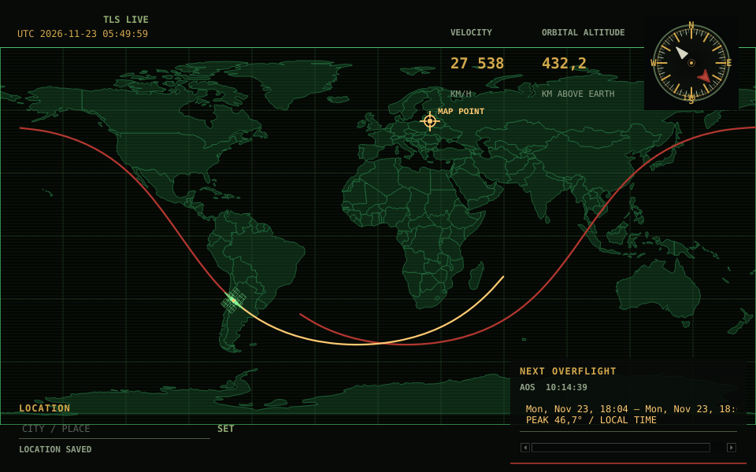

# ISS Tactical Tracker



Native C++17 / Qt 6 ISS tracker for Raspberry Pi 5 and desktop Linux.

## Features

- Live ISS telemetry and UTC clock
- 90-minute recent track and 30-minute projected track
- Red history trail and amber future trail
- Offline SVG world map
- Location selection and visible-pass forecast
- Tactical compass showing travel direction
- CRT-inspired military-style interface
- HTTPS response limits and cache validation
- Low-CPU mode and duplicate-instance protection

## Debian / Raspberry Pi OS

```sh
sudo apt update
sudo apt install build-essential cmake qt6-base-dev qt6-svg-dev git

git clone https://github.com/tsikibrikitambet-dotcom/iss-tracker-qt.git
cd iss-tracker-qt

cmake -S . -B build -DCMAKE_BUILD_TYPE=Release
cmake --build build --parallel
./build/iss_tracker
```

## Arch Linux

```sh
sudo pacman -Syu
sudo pacman -S base-devel cmake qt6-base qt6-svg git

git clone https://github.com/tsikibrikitambet-dotcom/iss-tracker-qt.git
cd iss-tracker-qt

cmake -S . -B build -DCMAKE_BUILD_TYPE=Release
cmake --build build --parallel
./build/iss_tracker
```

## Install as a User Command

```sh
install -Dm755 build/iss_tracker ~/.local/bin/iss_tracker
iss_tracker
```

Make sure ~/.local/bin is included in your PATH.

## Tests

```sh
cmake -S . -B build -DCMAKE_BUILD_TYPE=Release
cmake --build build --parallel
ctest --test-dir build --output-on-failure
```

## Controls

- Click the map to set your home location.
- Search for a city or place name.
- Red: recent ISS ground track.
- Amber: predicted ISS ground track.
- Compass: current travel heading.

## License

MIT License. See [LICENSE](LICENSE).

## Data Sources

- ISS telemetry: Where The ISS At?
- Place search: OpenStreetMap Nominatim
- Embedded world map: public-domain Natural Earth data
